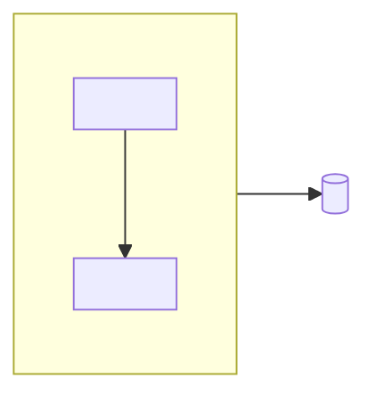

<!-- Template for <owner>/docs/architecture/diagrams/main.md. Copy the file, delete this comment.
The one statement of this owner's relationships at its own level: its immediate parts and the
external participants it relates to, as black boxes, each arrow labelled with the contract it goes
through. A part with its own architecture is one box; what is inside it, and its own dependencies,
belong to that part's main.md. No signatures, fields or payloads — the contract owns those.
A second perspective is not added here; it becomes its own <concern>.md beside this file, in this
same directory, and gains a row in README.md. -->

# Main view

<what this view shows, and what it deliberately leaves out — one line>

